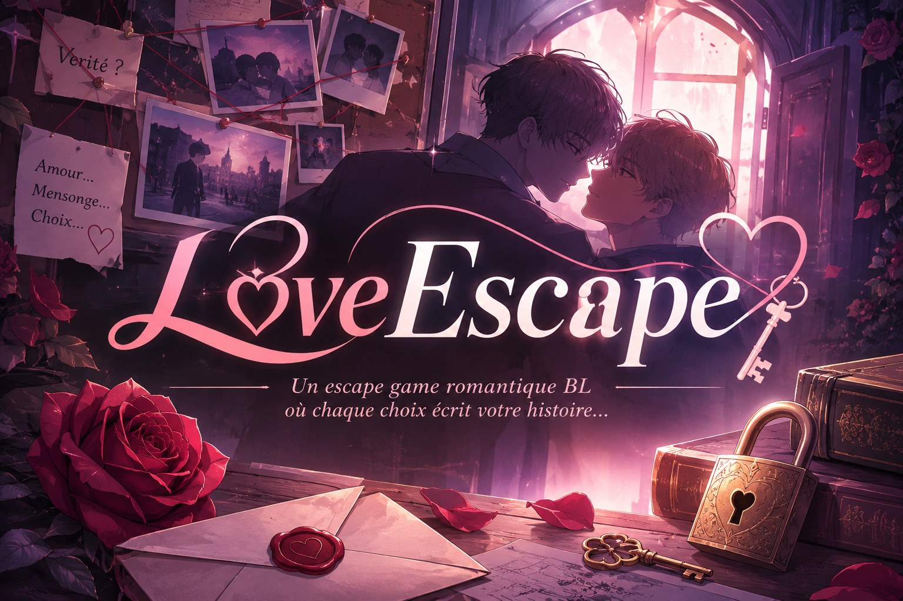

# Heartlock



## ▶ [Jouer à la démo](https://drstorydreamer-hub.github.io/Heartlock/)

### Premier dossier : Qui a embrassé qui ? L'affaire de l'escalier C

Un petit jeu narratif romantique, entièrement en français, jouable directement dans le navigateur, sur ordinateur comme sur téléphone.

À Bangkok, six amis fêtent les 25 ans d'Ayaan. Le lendemain matin, une vidéo de huit secondes apparaît dans l'album partagé de la soirée : deux silhouettes s'embrassent sous la pluie. Personne ne se dénonce. Tu es la seule personne qui peut démêler l'affaire.

**Durée :** 20 à 30 minutes · **Énigmes :** 5 · **Difficulté :** facile à intermédiaire

## Jouer

- **En ligne :** https://drstorydreamer-hub.github.io/Heartlock/
- **En local :** ouvre simplement `index.html` dans un navigateur. Aucun serveur ni installation n'est nécessaire.

Sur téléphone, le jeu s'affiche en plein écran. Sur iPhone comme sur Android, « Ajouter à l'écran d'accueil » le lance comme une application.

## Ce qu'il y a dans le jeu

- Des scènes illustrées (salon, cuisine, entrée, escalier C, supérette) dessinées en SVG, sans aucune image externe.
- Six personnages aux expressions qui changent selon les répliques.
- Des dialogues qui s'écrivent en direct, une discussion de groupe sur téléphone et la vidéo de KN-01 à regarder.
- Cinq énigmes interactives : la playlist et l'heure du baiser, le message chiffré de l'imperméable, la confrontation des alibis, les messages effacés, et les post-its du frigo.
- Deux fouilles, une accusation finale avec preuves, puis la révélation complète.
- Un carnet de détective (suspects à barrer, indices, répliques), des indices progressifs, une pluie animée et une petite musique synthétisée sur place.
- Une sauvegarde automatique de la partie dans le navigateur.

## Structure

```
assets/             Visuel de couverture
index.html          Le jeu assemblé, prêt à être servi (fichier unique)
build.sh            Assemble src/ en index.html
src/style.css       Design : palette pastel, mise en page, version téléphone
src/art.js          Illustrations : personnages, décors, palette des scènes
src/story.js        Scénario : toutes les scènes, répliques et données des énigmes
src/engine.js       Moteur : déroulé, énigmes, carnet, son, sauvegarde
tests/              Partie complète automatisée (Playwright)
```

Après une modification dans `src/`, relance :

```bash
bash build.sh
```

## Tester

Le test joue toute l'enquête, au format ordinateur puis au format téléphone, et enregistre des captures dans `tests/captures/`.

```bash
npm install playwright
npx playwright install chromium
node tests/partie-complete.js
```

## Publier la démo avec GitHub Pages

La démo est publiée automatiquement par `.github/workflows/pages.yml` à chaque envoi sur `main`.
Il faut l'activer une seule fois : **Settings → Pages → Build and deployment → Source : GitHub Actions**.

Les polices (Fredoka, Nunito, Pacifico, Patrick Hand) sont chargées depuis Google Fonts. Sans connexion, le jeu reste jouable avec les polices du système.
